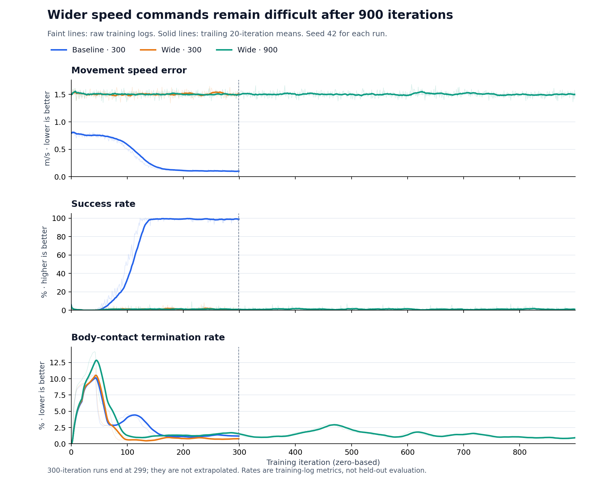

# Wider speed commands remain difficult after 900 iterations

NewUU Senior Track · Unitree Go2 · flat-terrain velocity tracking

## Prediction before training

The original prediction is preserved unchanged in [prediction.md](prediction.md):

> I expect slightly worse speed tracking when the linear command ranges increase from [-1, 1] to [-2, 2] m/s with the same 300 training iterations. The robot may struggle to achieve the faster requested speeds, causing larger tracking errors and lower tracking rewards.
>
> I think additional training may help it learn movements that follow the faster commands more accurately, but we need to test this.

## Experiment and measurement

I trained the default `Isaac-Velocity-Flat-Unitree-Go2-v0` task for 300 iterations, trained a fresh wider-range policy for 300 iterations, and trained another fresh wider-range policy for 900 iterations. Both X and Y command ranges were widened using Hydra overrides. Angular command limits remained ±1 rad/s; heading-command behavior was unchanged.

All runs used seed 42, 4,096 environments, 24 rollout steps per environment per iteration, PPO, and the Newton MJWarp backend. Thus the two 300-iteration runs each collected 29,491,200 transitions, while the 900-iteration run collected 88,473,600. Saved YAML comparisons confirm that only the intended ranges and training budget changed, alongside run labels and log paths.

The ranges are set in `CommandsCfg.base_velocity.ranges` in [velocity_env_cfg.py](https://github.com/isaac-sim/IsaacLab/blob/28a37cecdd433c22d9eabd6a5954add9f13a8951/source/isaaclab_tasks/isaaclab_tasks/manager_based/locomotion/velocity/velocity_env_cfg.py).

`error_vel_xy` measures episode-average XY velocity error in m/s. Success requires episode-average XY error below 0.5 m/s **and** yaw error below 0.4 rad/s. The logged base-contact metric averages each environment's most recent episode termination flag; it is a stability indicator, not a pooled percentage of every episode. Definitions were checked against the pinned [velocity command](https://github.com/isaac-sim/IsaacLab/blob/28a37cecdd433c22d9eabd6a5954add9f13a8951/source/isaaclab/isaaclab/envs/mdp/commands/velocity_command.py) and [termination manager](https://github.com/isaac-sim/IsaacLab/blob/28a37cecdd433c22d9eabd6a5954add9f13a8951/source/isaaclab/isaaclab/managers/termination_manager.py).

## What happened

These are unweighted averages over the **last 50 logged iterations** of each run: iterations 250–299 for the 300-iteration runs and 850–899 for the longer run.

| Run | X/Y ranges (m/s) | XY error ↓ | Success ↑ | Base contact ↓ | Mean reward ↑ |
|---|---|---:|---:|---:|---:|
| Baseline · 300 | [-1, 1] | 0.1025 m/s | 98.75% | 1.26% | 34.74 |
| Wide · 300 | [-2, 2] | 1.5113 m/s | 0.77% | 0.74% | 9.79 |
| Wide · 900 | [-2, 2] | 1.5026 m/s | 0.98% | 0.88% | 10.04 |

The baseline's speed error falls and its success approaches 100%. Both wider-range runs retain high speed error and very low success, even though their late base-contact rates are lower than the baseline's. Turning error remains comparatively similar: 0.1777, 0.1714, and 0.1665 rad/s, respectively. Staying upright and tracking turning commands therefore do not establish accurate linear movement.

The recordings show a walking baseline and wider-range policies that often hold a low posture, turn, and make limited progress. Camera movement prevents measuring exact speed from the videos; the logged metrics provide the quantitative comparison. The prediction was right about the direction of the change, but “slightly worse” underestimated its size.

## Did longer training fix it?

No. Increasing the wide-range budget from 300 to 900 iterations reduced late-window XY error by only about **0.6%**, from 1.5113 to 1.5026 m/s. Success increased by approximately **0.21 percentage points**, remaining below 1%. The longer policy still has about 14.7 times the baseline's late-window XY error.

This rules out the simple explanation that this seed would learn good wide-range tracking merely by increasing this budget to 900 iterations. It does **not** rule out recovery with still more training, other seeds, or different learning settings. The behavior is consistent with a policy that preserves balance and turning without solving the harder linear commands. A gradual command-range curriculum or a controlled reward investigation would be reasonable follow-up experiments, but neither mechanism was tested here.

## Limits and reproducibility

These are training logs from one seed per condition, not independent held-out evaluations. Log-point averages are not pooled episode rates, and smoothing is only for display: figures include raw values and trailing 20-iteration means. Shorter curves stop at iteration 299. The original events, saved configurations, extracted CSV, summary JSON, configuration differences, and executable analysis are included. [README.md](README.md) contains the training and playback commands; the exact Isaac Lab commit is recorded in [isaaclab_commit.txt](isaaclab_commit.txt).
